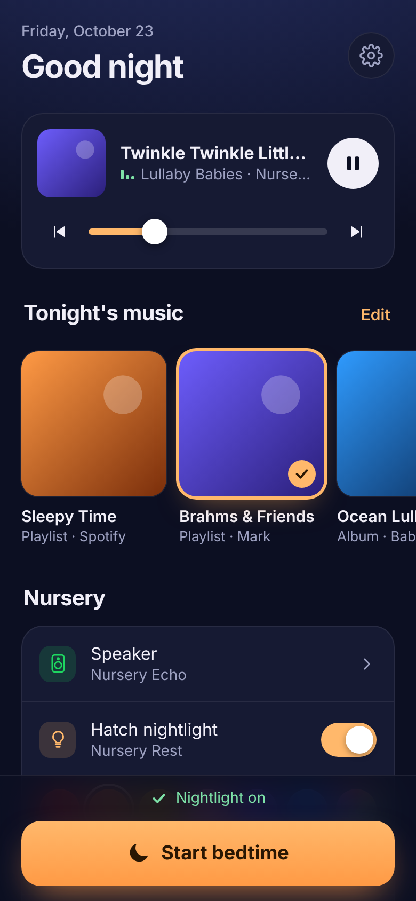

# Hatch-Baby

Play Spotify at bedtime with your Hatch as the nightlight. Switch to a Hatch
noise in the Hatch app whenever you're ready.

## Why it works this way

No Hatch model (Rest, Rest+, Rest 2nd gen, Rest Baby, Restore) can play
Spotify itself. Hatch has no Spotify Connect support, and Spotify doesn't
give out raw audio URLs the Hatch could stream. So at bedtime this:

1. starts your Spotify playlist on a **Spotify Connect speaker in the nursery**
   (Echo, Sonos, Google Nest, an old phone or tablet, ...), and
2. turns on the **Hatch nightlight** and stops any Hatch sound so the two
   don't play over each other.

The Hatch volume isn't changed. When you pick a noise in the Hatch app later,
it plays at its usual level. Your Hatch subscription, favorites and routines
are untouched.

Music keeps playing until you stop it. To stop it automatically, use the
speaker's own sleep timer (for example, "Alexa, stop the music in 45 minutes").

## Run it from anywhere (recommended)

Install it on an always-on machine and reach it from your phone through
Tailscale. See **[deploy/README.md](deploy/README.md)**. One script sets up a
Google Cloud VM, Raspberry Pi or spare computer, with nothing exposed to the
internet.

## Run it on your own computer

```bash
python3 -m venv .venv && source .venv/bin/activate
pip install -r requirements.txt
cp .env.example .env   # then fill it in
```

1. **Spotify** (playback control needs **Spotify Premium**):
   - Create an app at <https://developer.spotify.com/dashboard>.
   - Add the redirect URI `http://127.0.0.1:8888/callback`.
   - Copy the Client ID and Client Secret into `.env`.
2. **Hatch**: put your Hatch Sleep app email and password in `.env`.
   The Hatch connection goes through the unofficial
   [`hatch_rest_api`](https://github.com/dahlb/ha_hatch) library, the same
   one the Home Assistant Hatch integration uses.

### Web UI

```bash
python hatch_ui.py
```



Open <http://127.0.0.1:8888> and tap **Connect Spotify** once.

From the page you can:
- save playlists and albums from Spotify links (shared by everyone who uses the page)
- pick tonight's music, the nursery speaker and the nightlight color, then tap **Start bedtime**
- control playback and volume

Add it to your phone's home screen and it opens full screen with its own icon.

The page is dark so it won't light up the room. By default only this computer
can open it. To use it from your phone on home Wi-Fi, set `UI_PASSWORD` in
`.env` and run `python hatch_ui.py --host 0.0.0.0`, then open
`http://<computer's-IP>:8888`. The Spotify login still has to happen on the
computer itself.

<br clear="right">

### Command line

```bash
# See what's available
python hatch_spotify.py devices

# Play a playlist on the nursery speaker, with an orange Hatch nightlight
python hatch_spotify.py play https://open.spotify.com/playlist/37i9dQZF1DWZd79rJ6a7lp \
    --speaker "Nursery Echo" --volume 25

# Stop Spotify (add --hatch-off to turn the Hatch off too)
python hatch_spotify.py stop
```

The first command-line run prints a Spotify login URL. Open it, approve, and
paste the URL you're redirected to back into the terminal.

`play` options: `--color ff0000`, `--brightness 10`, `--shuffle/--no-shuffle`,
`--hatch "Nursery"` (if you have several Hatches), and `--no-hatch`.

### Bonus: audio on the Hatch speaker itself

The Rest 2nd gen and Rest Baby can stream a **public MP3/WAV URL** (your own
recordings, a lullaby file you host, and so on). This doesn't work with
Spotify:

```bash
python hatch_spotify.py play-url https://example.com/lullaby.mp3 --volume 40
```

## Tests

```bash
python -m unittest -v
```

## Notes

- The Spotify speaker must show up in the list. If it doesn't, open Spotify
  and play something on it once.
- The Hatch API is unofficial and could break if Hatch changes its cloud.
- Keep `.env` private; it's already in `.gitignore`.
